# Suggested Repository Descriptions / Descrições Sugeridas para o Repositório

> **GitHub About Description (English):**
> Presentation and study material on People Management: Objectivity, Subjectivity, Theoretical Approaches, and Soft vs. Hard HR Versions.

> **Descrição Sobre o Repositório (Português):**
> Apresentação e material de estudo sobre Gestão com Pessoas: Objetividade, Subjetividade, Abordagens Teóricas e Versões Leve e Pesada do RH.

---

# English Version

# People Management: Objectivity and Subjectivity

## 📌 Repository Description
> Academic presentation and study material exploring Human Resources Management (HRM), analyzing key theoretical approaches (functionalist, strategic, political), HRM versions (soft and hard), and the interplay between organizational objectivity and human subjectivity.

---

## 📖 About the Project
This repository hosts the slide presentation titled **"Gestão com Pessoas, Objetividade e Subjetividade"** (*People Management, Objectivity and Subjectivity*), authored by Lucas Veríssimo and Gabriel Brito.

### Key Topics Covered:
1. **Evolution of Human Resources Management (HRM):**
   - Historical roots starting in the late 19th century.
   - Significant advancements post-1947 led by Elton Mayo's Hawthorne experiments.
   - Transition from a cost center to a strategic core area post-1970.
2. **Three Predominant Approaches:**
   - **Functionalist Approach:** Focuses on functional tasks (recruitment, training, compensation, performance evaluation) to guide and reinforce workforce behavior.
   - **Strategic Approach:** Adapts to market pressures, global competitiveness, and environmental shifts by fostering flexibility and organizational learning.
   - **Political Approach:** Examines areas of convergence and conflict between individual interests and corporate goals, incorporating social and ethical dynamics.
3. **Versions of HRM:**
   - **Soft HR (Versão Leve):** Emphasizes policy integration with organizational goals, proactive employee involvement, mutual trust, and human potential development.
   - **Hard HR (Versão Pesada):** Reflects utilitarian instrumentalism, focusing on quantitative metrics, strategic alignment, cost minimization, and performance calculation.
4. **Subjectivity and Objectivity:**
   - Highlights how individual traits, creativity, intuition, and human experiences make organizational objectivity attainable.
5. **Conclusions:**
   - People management extends beyond isolated HR policies or single departmental duties; it must cultivate competitive advantages for the firm while delivering equitable advantages for employees.

---

## 💻 How to View the Project

1. **Option 1: Read Directly on GitHub (Recommended)**
   - Scroll down to the [Presentation Screenshots](#-presentation-screenshots) section to view all slides rendered in high resolution.

2. **Option 2: Open the Presentation PDF**
   - Clone the repository:
     ```bash
     git clone https://github.com/lucasverissimo159/gestao_pessoas_presentation.git
     ```
   - Open `Gestão com Pessoas.pdf` with any PDF viewer (e.g., Adobe Acrobat Reader, SumatraPDF) or directly in your web browser (Google Chrome, Mozilla Firefox, Microsoft Edge, Safari).

---

## 📸 Presentation Screenshots

<div align="center">

### Slide 1 — Title
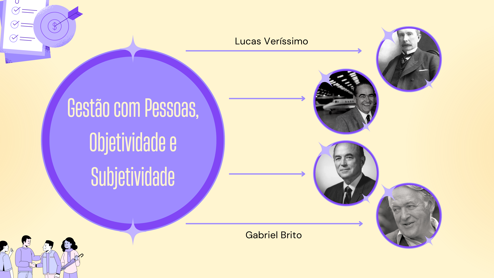

### Slide 2 — Overview & Index
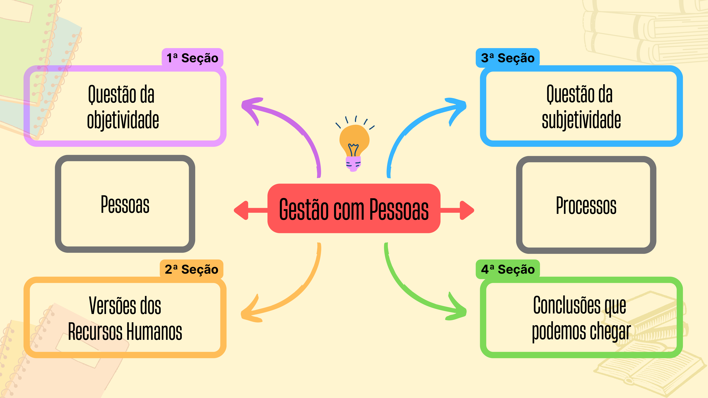

### Slide 3 — HRM Theoretical Approaches Overview
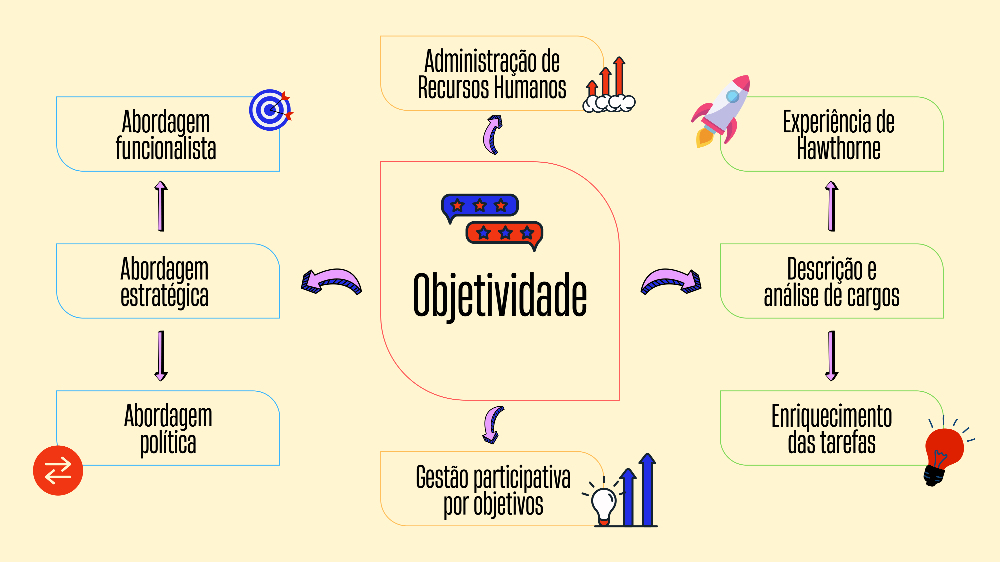

### Slide 4 — Human Resources Management Evolution
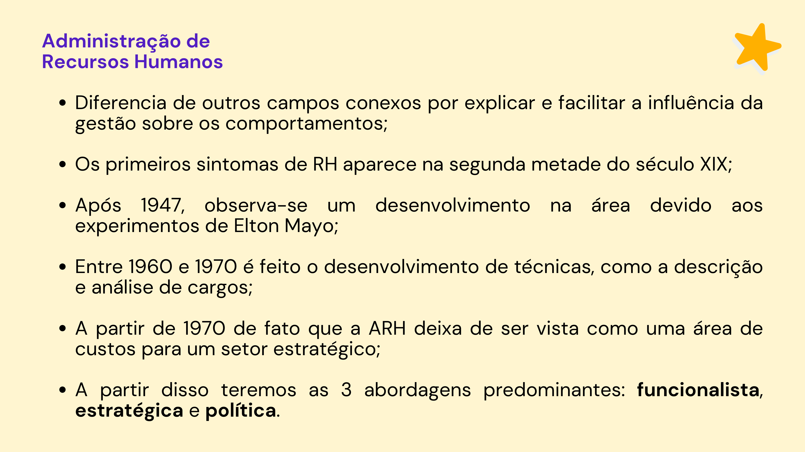

### Slide 5 — Functionalist Approach
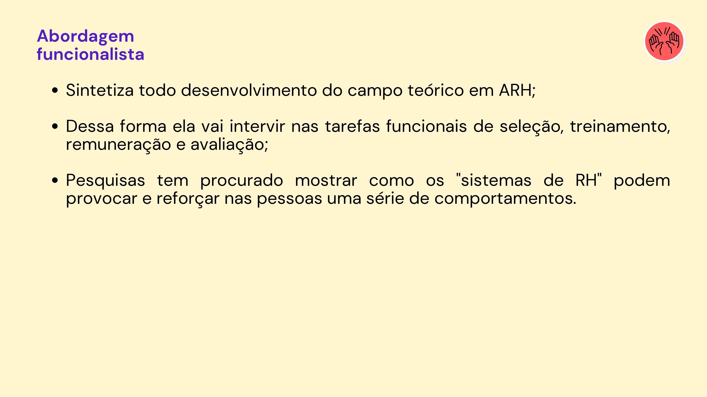

### Slide 6 — Strategic Approach
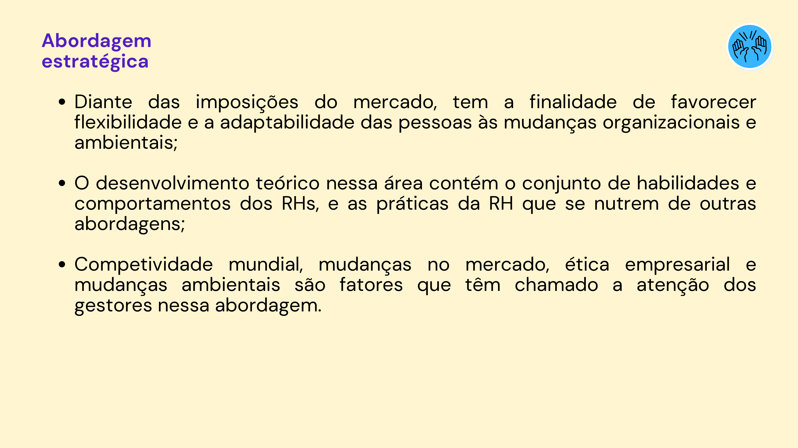

### Slide 7 — Political Approach
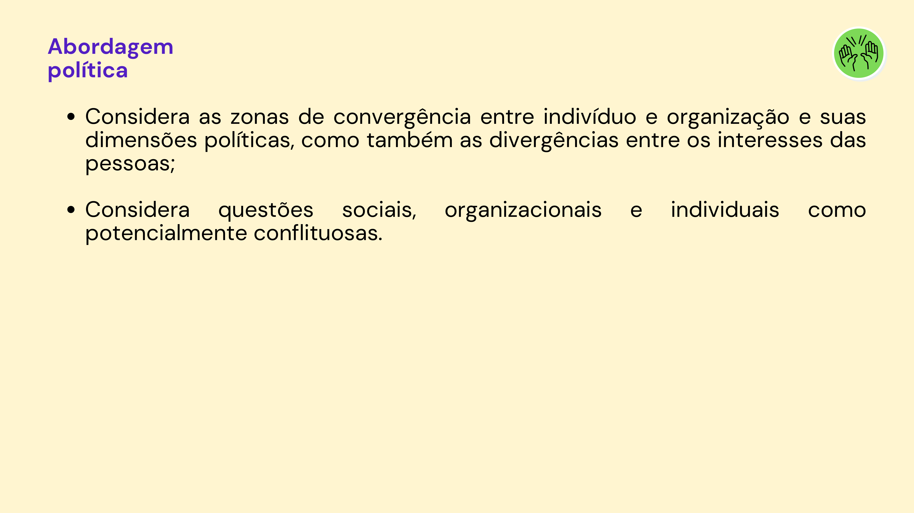

### Slide 8 — Comparative Summary of Approaches
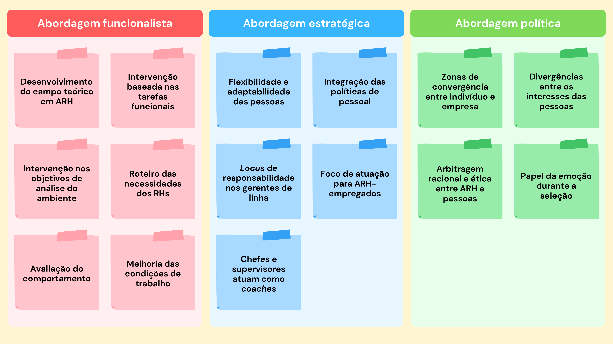

### Slide 9 — Versions of HRM Model
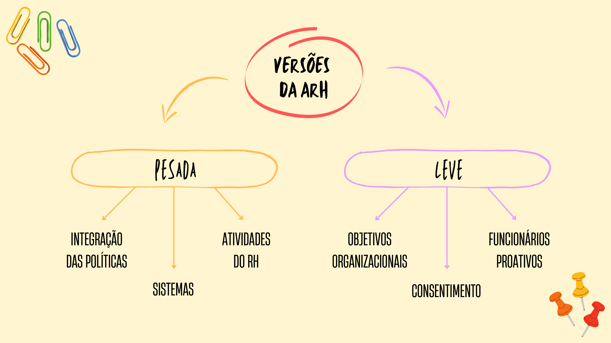

### Slide 10 — Soft Version of HRM
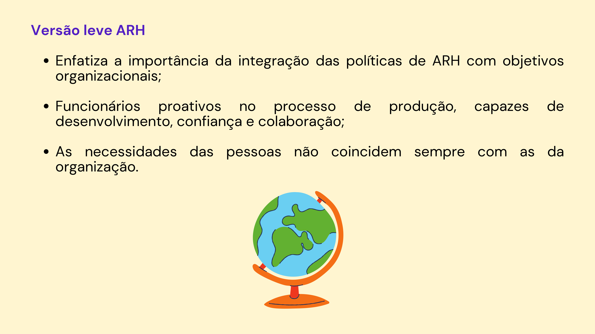

### Slide 11 — Hard Version of HRM
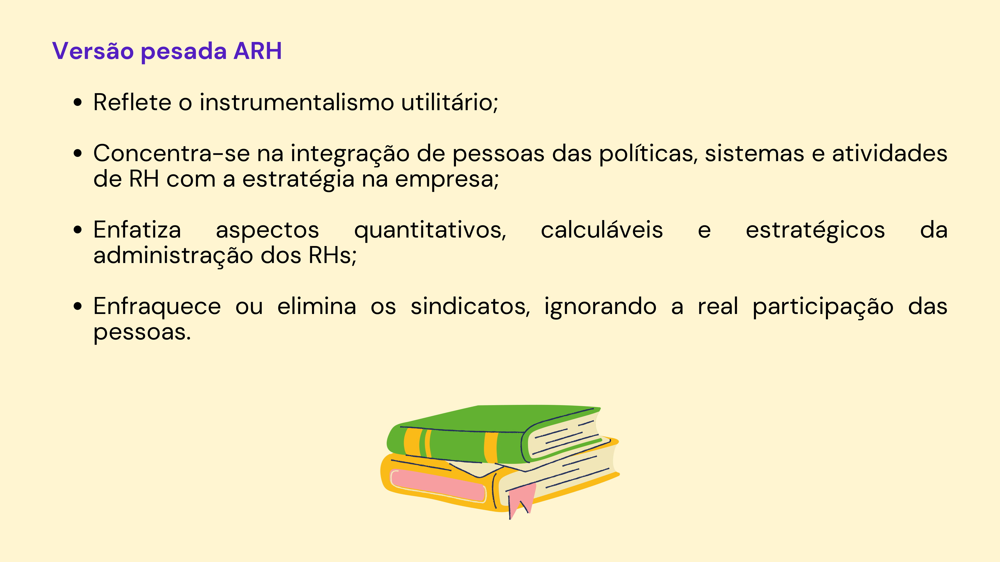

### Slide 12 — Subjectivity and Objectivity
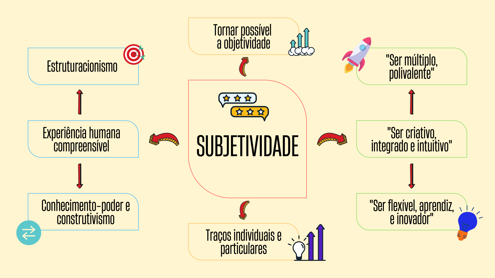

### Slide 13 — Conclusions
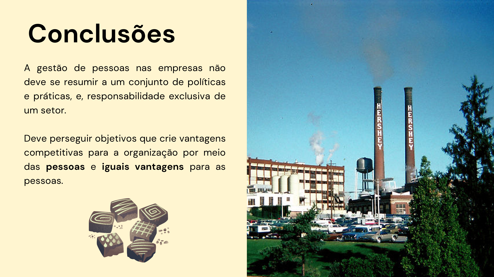

</div>

---

# Versão em Português

# Gestão com Pessoas: Objetividade e Subjetividade

## 📌 Descrição para o Repositório
> Apresentação acadêmica e material de estudo sobre Gestão com Pessoas, explorando objetividade, subjetividade, abordagens teóricas (funcionalista, estratégica e política) e as versões leve e pesada do RH.

---

## 📖 Sobre o Projeto
Este repositório contém a apresentação de slides intitulada **"Gestão com Pessoas, Objetividade e Subjetividade"**, elaborada por Lucas Veríssimo e Gabriel Brito.

### Principais Tópicos Abordados:
1. **Evolução da Administração de Recursos Humanos (ARH):**
   - Primeiros traços no final do século XIX.
   - Desenvolvimento acentuado após 1947 com a Experiência de Hawthorne (Elton Mayo).
   - Transição do RH como centro de custos para um setor estratégico a partir da década de 1970.
2. **Três Abordagens Predominantes:**
   - **Abordagem Funcionalista:** Foco em intervenções nas tarefas funcionais (seleção, treinamento, remuneração e avaliação) para induzir comportamentos esperados.
   - **Abordagem Estratégica:** Resposta às demandas de mercado, competitividade global e mudanças ambientais, promovendo flexibilidade e adaptabilidade.
   - **Abordagem Política:** Análise das convergências e divergências de interesses entre indivíduos e organização, contemplando mediação racional e ética de conflitos.
3. **Versões da ARH:**
   - **Versão Leve (Soft):** Prioriza a integração das políticas organizacionais com o desenvolvimento humano, proatividade, colaboração e confiança mútua.
   - **Versão Pesada (Hard):** Reflete o instrumentalismo utilitário, com foco em métricas quantitativas, custos calculáveis e alinhamento rígido às estratégias corporativas.
4. **Objetividade e Subjetividade:**
   - Demonstra como a experiência humana, criatividade, intuição e traços individuais viabilizam e sustentam a objetividade organizacional.
5. **Conclusões:**
   - A gestão de pessoas deve ir além de rotinas operacionais ou responsabilidade exclusiva de um departamento; deve gerar vantagens competitivas para a empresa e, ao mesmo tempo, promover o desenvolvimento e benefício das pessoas.

---

## 💻 Como Abrir o Projeto

1. **Opção 1: Visualizar Diretamente no GitHub (Recomendado)**
   - Role até a seção [Demonstração das Páginas](#-demonstração-das-páginas-screenshots) para visualizar todos os slides em alta resolução.

2. **Opção 2: Abrir o PDF Original**
   - Clone o repositório:
     ```bash
     git clone https://github.com/lucasverissimo159/gestao_pessoas_presentation.git
     ```
   - Abra o arquivo `Gestão com Pessoas.pdf` em qualquer leitor de PDF (ex: Adobe Acrobat, SumatraPDF) ou no seu navegador web preferido (Google Chrome, Firefox, Edge, Safari).

---

## 📸 Demonstração das Páginas (Screenshots)

<div align="center">

### Slide 1 — Título


### Slide 2 — Visão Geral & Sumário


### Slide 3 — Abordagens em ARH


### Slide 4 — Evolução da ARH


### Slide 5 — Abordagem Funcionalista


### Slide 6 — Abordagem Estratégica


### Slide 7 — Abordagem Política


### Slide 8 — Quadro Comparativo das Abordagens


### Slide 9 — Modelo de Versões da ARH


### Slide 10 — Versão Leve da ARH


### Slide 11 — Versão Pesada da ARH


### Slide 12 — Subjetividade e Objetividade


### Slide 13 — Conclusões


</div>
